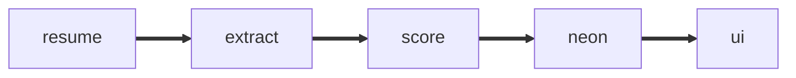

<picture><source media="(prefers-color-scheme: dark)" srcset="docs/logo_dark.svg"></picture>


It'll Read All the 47 Resume with Make a LCA or UI/Ux With If it's not found it make a uncertain. It Make the Every scores shows the evidance. Upload a new resume and how it lands in the pile.



## Quick:

```bash
pn i && cp .env.example .env
pn migrate && pn seed # Add DB_UL
pn dev
```


## Tech stack

- Next.js
- Postgres
- mammoth and unpdf
- Zod
- Tailwind CSS 4
- Vitest

## Method
1. Read: text is pulled from the file. No text means a clear error, never a silent skip.
2. Split: headings (Experience, Projects, Education, Core Skills, Tools, Certifications) split the text. Roles are read with dates. Overlapping roles count once.
3. Match: term lists built from each job description are matched on normalised text.
4. Score: a fixed 100 point rubric per role (see the How it works page in the app). Each point has a note.
5. Classify: a role qualifies at score 40 or more with at least one core term (LCA, life cycle, EPD, or UI, UX, Figma, product design). Both needs two qualifying roles within 15 points. Neither qualifying is uncertain.
6. Rank: by score, then must-haves met, then relevant years.


## Cleaning the output
- Printed parsed jobs, education, years and issues for all 47 resumes and compared them with the source text.
- Fixed date formats the first run missed: `11/2025`, `Sep ’25`, `Jan 26`, `Jan – April 2026`, `8 Months`.
- Fixed `March` matching the M.Arch degree pattern, which split school lines wrongly.
- Fixed `cradle - to - gate` not matching, by normalising spaced hyphens.
- Removed the first line from matching. One resume is tagged `UI`, which hit the design keyword.
- Spot checked score breakdowns of NP, RR, MS, PW and KN against their resumes.


- 1 file has no readable text (`anonymized_resume_1793685080327.docx`). Marked unreadable, not scored.
- 12 files have ISO numbers blanked by anonymisation. They get half marks and a note.
- 6 files have roles without dates or dates in odd formats. Those roles add no years.
- 2 files claim more years in the summary than the dated roles show. Noted for the reviewer.

# Thanks.